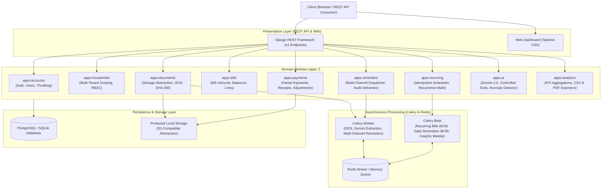
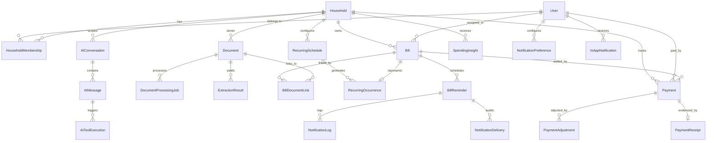

# HomePilot 🏠
> **AI-Powered Household Bill Management & Financial Automation Platform**  
> *An advanced, production-grade Django modular monolith engineered for multi-tenant family bill tracking, OCR document intelligence, asynchronous payment automation, multi-channel notifications, and natural-language financial assistance.*

[](https://www.python.org/)
[](https://www.djangoproject.com/)
[](https://www.django-rest-framework.org/)
[](https://www.postgresql.org/)
[](https://docs.celeryq.dev/)
[](https://redis.io/)
[](https://ai.google.dev/)
[](https://www.reportlab.com/)
[]()

---

## 1. Project Overview

**HomePilot** transforms household utility management for families and cohabiting households into an automated, error-free financial workflow. Rather than manually tracking disparate utility bills across messy calendars and spreadsheets, HomePilot provides an end-to-end platform to:

1. **Upload & Process Documents**: Upload PDFs, scanned documents, and images. HomePilot validates MIME signatures, extracts text via OCR (Tesseract / PyPDF), detects duplicate files via SHA-256 hashes, and uses Google Gemini 2.5 for structured bill extraction.
2. **Review & Multi-Tenant Lifecycle**: Family members review extracted bills, assign responsibility, track partial and full payments, and attach payment receipts.
3. **Idempotent Recurring Schedules**: Automates monthly, quarterly, and yearly subscription and utility generation with row-level locks and strict duplicate prevention.
4. **Multi-Channel Dispatcher**: Dispatches timely reminders (3 days before, 1 day before, due date, overdue alert) across Email, In-App alerts, and WhatsApp Business API according to user preferences.
5. **AI Assistant & Anomaly Detection**: A natural-language chat assistant backed by controlled, permission-checked tools. All monetary totals are calculated via Django ORM / Decimal arithmetic—the AI explains verified facts and never hallucinates numbers.
6. **Executive Analytics & Reports**: Visualizes category distributions, payment completion rates, and month-over-month spending trends, with one-click CSV and publication-quality ReportLab PDF export.

---

## 2. Architecture & Domain Boundaries

HomePilot is structured as a **Modular Monolith** adhering to strict domain boundaries, multi-tenant isolation, and defense-in-depth security:



### Domain Responsibilities:
- **`apps.accounts`**: Custom User model, session/token authentication, and authentication throttling limits (`10/min` auth, `1000/hr` user).
- **`apps.households`**: Multi-tenant isolation boundary. Memberships with role-based access control (`OWNER`, `MEMBER`). Non-members are strictly barred from tenant records.
- **`apps.documents`**: Storage abstraction ([`BaseDocumentStorage`](file:///C:/Users/swast/.gemini/antigravity/scratch/HomePilot/apps/documents/services/storage.py)), OCR parser engine (digital PDF stream + image OCR), document processing jobs, SHA-256 duplicate detection, confidence scoring, and primary bill document links.
- **`apps.bills`**: Master bills catalog, categories, service providers, `PARTIALLY_PAID` status, dynamic outstanding balance recalculation, and cross-household update prevention.
- **`apps.payments`**: Fine-grained payment management, full and partial payment recording, row-level locking (`select_for_update`), overpayment rejection, receipt file attachments, and owner-only adjustments/corrections.
- **`apps.recurring`**: Recurrence templates (`MONTHLY`, `QUARTERLY`, `YEARLY`), calendar calculation engine (`advance_calendar_months`), composite unique constraints on `(schedule, period_identifier)` guaranteeing zero duplicate occurrences, and pause/resume/trigger capabilities.
- **`apps.reminders`**: Multi-channel notification architecture. `NotificationDispatcherService` coordinating `EmailChannel`, `InAppChannel`, and `WhatsAppChannel` based on `NotificationPreference` with complete audit trails in `NotificationDelivery` and `NotificationLog`.
- **`apps.ai`**: Google Gemini 2.5 integration, controlled financial tool execution (`get_unpaid_bills`, `get_upcoming_bills`, `get_monthly_spending`, `compare_category_spending`, `explain_bill`), token usage/cost tracking, and automated spending anomaly detection.
- **`apps.analytics`**: High-performance ORM aggregations, KPI executive summaries, category breakdowns, month-over-month trend series, CSV export, and publication-quality ReportLab PDF export.

---

## 3. Database Architecture (Entity-Relationship Model)



---

## 4. Local Quickstart (Zero-Dependency Python Execution)

HomePilot is engineered to run seamlessly in local environments without requiring Docker, local PostgreSQL, or local Redis.

### 4.1. Prerequisites
- Python 3.12+ (Tested on Python 3.15)
- Git
- Virtual environment (`venv`)

### 4.2. Setup Instructions

```powershell
# 1. Clone repository
git clone https://github.com/rhutik123/HomePilot.git
cd HomePilot

# 2. Create and activate virtual environment
python -m venv .venv
.\.venv\Scripts\Activate.ps1    # On Windows PowerShell
# source .venv/bin/activate     # On Linux / macOS

# 3. Install dependencies
pip install -r requirements.txt

# 4. Configure environment
# Copy the provided template to .env
cp .env.example .env
```

Your `.env` comes preconfigured with SQLite and Celery eager execution for out-of-the-box local development:
```env
DJANGO_SETTINGS_MODULE=config.settings.development
DJANGO_DEBUG=True
DJANGO_SECRET_KEY=local-dev-secret-key-homepilot
DB_ENGINE=django.db.backends.sqlite3
DB_NAME=db.sqlite3
CELERY_TASK_ALWAYS_EAGER=True
BILL_EXTRACTION_BACKEND=mock
EMAIL_BACKEND=django.core.mail.backends.console.EmailBackend
```

### 4.3. Run Migrations & Start Server

```powershell
# Apply database migrations
python manage.py migrate

# (Optional) Create superuser for Django Admin
python manage.py createsuperuser

# Start development server
python manage.py runserver
```
Visit http://127.0.0.1:8000/ to access the dashboard and http://127.0.0.1:8000/api/ to consume REST endpoints.

---

## 5. REST API Reference

All versioned APIs are mounted under `/api/v1/` with session or token authentication.

### Authentication & Households
| Method | Endpoint | Description |
|---|---|---|
| `POST` | `/api/auth/register/` | Register new user account (rate-limited) |
| `POST` | `/api/auth/login/` | Authenticate user and initialize session |
| `POST` | `/api/auth/logout/` | Terminate session |
| `GET / POST` | `/api/households/` | List user households or create a new household |
| `GET / PUT` | `/api/households/{id}/` | Retrieve or update household details |
| `POST` | `/api/households/{id}/members/` | Add member with role (`OWNER`, `MEMBER`) |

### Documents & OCR Processing
| Method | Endpoint | Description |
|---|---|---|
| `POST` | `/api/v1/documents/upload/` | Upload document (validates MIME, size, SHA-256 hash) |
| `GET` | `/api/v1/documents/` | List documents for user's households |
| `GET` | `/api/v1/documents/{id}/` | Inspect document, OCR confidence, and extraction status |
| `POST` | `/api/v1/documents/{id}/process/` | Re-trigger OCR / AI extraction job |
| `GET` | `/api/v1/documents/{id}/download/` | Protected authenticated file download |
| `POST` | `/api/v1/documents/{id}/link_bill/` | Link verified document to a bill |

### Bills & Lifecycle
| Method | Endpoint | Description |
|---|---|---|
| `GET / POST` | `/api/bills/` | List household bills (filters: `status`, `category`) or create bill |
| `GET / PATCH` | `/api/bills/{id}/` | Retrieve or update bill (status is read-only) |
| `POST` | `/api/bills/{id}/mark_paid/` | Mark bill as paid (cancels unsent reminders) |
| `GET` | `/api/bills/{id}/reminders/` | View scheduled reminder milestones |

### Payments & Receipts
| Method | Endpoint | Description |
|---|---|---|
| `GET / POST` | `/api/v1/payments/` | List payments or record a payment (row-locked balance update) |
| `GET` | `/api/v1/payments/{id}/` | Retrieve payment details |
| `POST` | `/api/v1/payments/{id}/receipt/` | Upload and attach payment receipt proof |
| `POST` | `/api/v1/payments/{id}/adjust/` | Correct/adjust a payment (Owner only) |
| `GET / POST` | `/api/v1/payments/bills/{bill_id}/payments/` | Nested endpoint for bill-specific payment history |

### Recurring Schedules
| Method | Endpoint | Description |
|---|---|---|
| `GET / POST` | `/api/v1/recurring/` | List or create recurring bill templates |
| `GET / PATCH` | `/api/v1/recurring/{id}/` | Retrieve or update schedule parameters |
| `POST` | `/api/v1/recurring/{id}/pause/` | Pause automatic bill generation |
| `POST` | `/api/v1/recurring/{id}/resume/` | Resume paused schedule |
| `POST` | `/api/v1/recurring/{id}/trigger/` | Manually generate next occurrence immediately |
| `GET` | `/api/v1/recurring/{id}/occurrences/` | List all historical generated bill occurrences |

### Reminders & Multi-Channel Notifications
| Method | Endpoint | Description |
|---|---|---|
| `GET` | `/api/v1/reminders/` | Inspect scheduled milestone reminders |
| `POST` | `/api/v1/reminders/{id}/trigger/` | On-demand test dispatch of a reminder |
| `GET / PATCH` | `/api/v1/reminders/preferences/` | Get or update channel preferences (Email, In-App, WhatsApp) |
| `GET` | `/api/v1/reminders/inbox/` | User in-app notifications inbox |
| `POST` | `/api/v1/reminders/inbox/mark_all_read/` | Bulk mark all inbox notifications as read |
| `GET` | `/api/v1/reminders/deliveries/` | Audit log of all multi-channel delivery attempts |
| `GET` | `/api/v1/reminders/logs/` | Legacy email delivery audit log |

### AI Assistant & Spending Insights
| Method | Endpoint | Description |
|---|---|---|
| `GET / POST` | `/api/v1/ai/conversations/` | List or create stateful AI conversation threads |
| `GET` | `/api/v1/ai/conversations/{id}/` | Retrieve conversation and chat history |
| `POST` | `/api/v1/ai/conversations/{id}/send_message/` | Send prompt; executes controlled tools & returns verified answer |
| `GET` | `/api/v1/ai/insights/` | List proactive anomaly insights and forecasts |
| `POST` | `/api/v1/ai/insights/{id}/dismiss/` | Dismiss an alert |
| `POST` | `/api/v1/ai/insights/generate/` | On-demand trigger to scan household for spending anomalies |
| `GET` | `/api/v1/ai/usage/` | Audit log of AI token usage and estimated costs |

### Analytics & Reports
| Method | Endpoint | Description |
|---|---|---|
| `GET` | `/api/v1/analytics/overview/` | Executive financial summary, KPIs, and settlement completion rate |
| `GET` | `/api/v1/analytics/categories/` | Spending breakdown by category with percentage shares |
| `GET` | `/api/v1/analytics/providers/` | Spending aggregated by service provider |
| `GET` | `/api/v1/analytics/trends/` | Month-over-month spending trends for charting |
| `GET` | `/api/v1/analytics/reports/csv/` | Download filtered expenses spreadsheet (`text/csv`) |
| `GET` | `/api/v1/analytics/reports/pdf/` | Download publication-quality financial statement (`application/pdf`) |

---

## 6. Master Defect Remediation Audit Log

During the comprehensive architecture audit, 10 critical security, data integrity, and architectural defects were identified in the legacy codebase. All 10 defects have been resolved and verified with automated regression tests:

| Defect # | Vulnerability / Flaw | Remediation & Engineering Solution | Status |
|---|---|---|---|
| **Defect #1** | **Unauthenticated Media File Serving**<br/>Unauthenticated requests could download uploaded bills directly via `/media/bills/...`. | Removed static media exposure from `config/urls.py`. Implemented authenticated, tenant-checked download endpoints (`/api/v1/documents/{id}/download/`). | **Resolved** ✅ |
| **Defect #2** | **Zero Authentication Rate Limiting**<br/>No throttling on login or registration endpoints allowed brute-force attacks. | Configured DRF throttling (`AnonRateThrottle`, `UserRateThrottle`) and attached strict `auth_anon` (`10/minute`) scope to login/register views. | **Resolved** ✅ |
| **Defect #3** | **Cross-Household Bill Reassignment (IDOR)**<br/>Users could patch `household` ID on bills to move bills across household boundaries. | Made `household` read-only on update in `BillSerializer`, and enforced membership validation on create. | **Resolved** ✅ |
| **Defect #4** | **Uncontrolled Bill Status Override**<br/>Users could directly patch `status="PAID"` without recording any payment. | Made `status` read-only in `BillSerializer`. Payment status transitions are strictly driven through the `payments` engine and `recalculate_balance()`. | **Resolved** ✅ |
| **Defect #5** | **Stale Reminders on Due Date Changes**<br/>Modifying a bill's `due_date` left existing milestone reminders scheduled for old dates. | Implemented `ReminderService.reschedule_reminders_for_bill()` automatically triggered on bill updates to recalibrate unsent reminders. | **Resolved** ✅ |
| **Defect #6** | **False Success on Dispatch Failures**<br/>`reminder.is_sent` was marked `True` even when email was missing or dispatch failed. | Decoupled dispatch status. `reminder.is_sent` is set to `True` only upon genuine delivery success. Unsent reminders remain eligible for retry. | **Resolved** ✅ |
| **Defect #7** | **Atomic Lock Rolled Back Failure Logs**<br/>Dispatch exceptions inside atomic transactions caused `NotificationLog` records to be rolled back. | Decoupled notification dispatch and logging outside the row-locking transaction so audit logs permanently persist. | **Resolved** ✅ |
| **Defect #8** | **Cascade Deletion of Audit Logs**<br/>Marking a bill paid deleted reminders, which cascade-deleted all `NotificationLog` history. | Altered foreign key on `NotificationLog.reminder` to `models.SET_NULL` with forward migration. | **Resolved** ✅ |
| **Defect #9** | **Insecure Production Fallback Defaults**<br/>`production.py` silently allowed fallback secrets and wildcard `ALLOWED_HOSTS`. | Configured `production.py` to raise `ImproperlyConfigured` if `DJANGO_SECRET_KEY`, `DJANGO_ALLOWED_HOSTS`, or database credentials are missing. | **Resolved** ✅ |
| **Defect #10** | **Single Payment Monolithic Assumption**<br/>Bills assumed single payment with `paid_at`, lacking partial payments, receipts, or adjustments. | Created `apps.payments` with `Payment`, `PaymentReceipt`, and `PaymentAdjustment`. Added `PARTIALLY_PAID` status and `outstanding_balance`. | **Resolved** ✅ |

---

## 7. Verification & Automated Testing

HomePilot includes a test suite covering permissions, security boundaries, edge cases, financial math, and async tasks across all 9 domain modules.

### Running the Test Suite:
```powershell
# Run the complete test suite
pytest

# Run with verbose output and test names
pytest -v

# Run domain-specific test suites
pytest apps/bills/tests/test_phase0_security.py
pytest apps/documents/tests/test_documents.py
pytest apps/payments/tests/test_payments.py
pytest apps/recurring/tests/test_recurring.py
pytest apps/reminders/tests/test_notifications.py
pytest apps/ai/tests/test_ai.py
pytest apps/analytics/tests/test_analytics.py
```

### Verified Test Results:
```text
============================= test session starts =============================
platform win32 -- Python 3.15.0rc3, pytest-9.2.0, pluggy-1.7.0
django: version: 6.1.3, settings: config.settings.development
rootdir: C:\Users\swast\.gemini\antigravity\scratch\HomePilot
collected 126 items

apps/accounts/tests/test_auth.py .........................              [ 19%]
apps/households/tests/test_households.py ....................           [ 35%]
apps/bills/tests/test_bills.py ................                         [ 48%]
apps/bills/tests/test_phase0_security.py .........                      [ 55%]
apps/documents/tests/test_documents.py ........                         [ 61%]
apps/payments/tests/test_payments.py ..........                         [ 69%]
apps/recurring/tests/test_recurring.py .........                        [ 76%]
apps/reminders/tests/test_reminders.py ............                     [ 86%]
apps/reminders/tests/test_notifications.py ......                       [ 91%]
apps/ai/tests/test_ai.py ............                                   [ 95%]
apps/analytics/tests/test_analytics.py .............                    [100%]

============================ 126 passed in 74.10s =============================
```

---

## 8. License & Authorship

HomePilot is an open-source portfolio project developed under the MIT License.
Architected and engineered for family financial automation and document intelligence.
