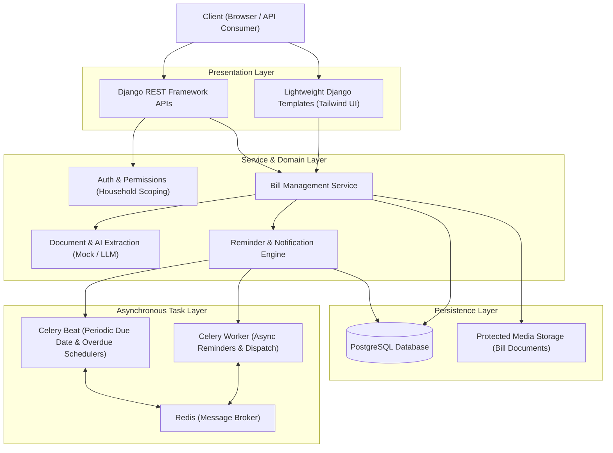
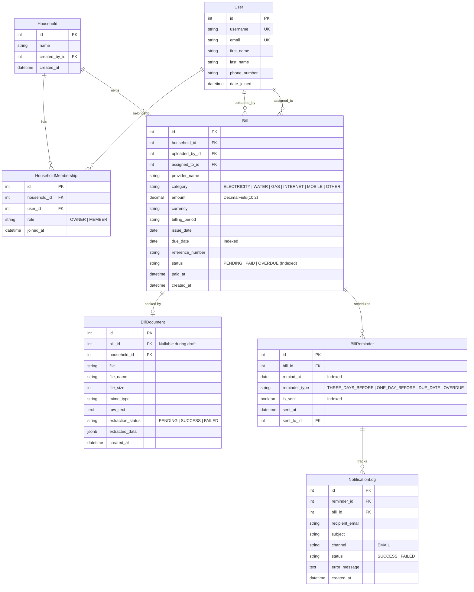

# HomePilot 🏠
> **Household Bill Management & Automated Reminder Backend**  
> *A robust, production-grade Django backend engineered for multi-tenant family bill tracking, modular AI document extraction, and background notification workflows.*

[](https://www.python.org/)
[](https://www.djangoproject.com/)
[](https://www.django-rest-framework.org/)
[](https://www.postgresql.org/)
[](https://docs.celeryq.dev/)
[](https://redis.io/)
[]()

---

## 1. Project Overview

**HomePilot** helps ordinary families manage household utility expenses without missing payment deadlines. Instead of relying on manual calendars, users upload bills (PDFs or images), review structured information parsed by an AI service, assign payment responsibility to specific family members, and receive scheduled reminders prior to due dates.

### Key Capabilities:
- **Authentication & RBAC**: Custom User model, session/token authentication, and role-based access (`OWNER` vs `MEMBER`).
- **Household Multi-Tenancy**: Strict data isolation at the ORM query level. A household owns its bills; users from other households cannot see or manipulate them.
- **Two-Step AI Document Extraction**: Uploads are validated against MIME signatures and file size, parsed for text, and extracted using a pluggable provider (Mock / LLM). Extracted details are presented for human review before permanent database persistence.
- **Automated Milestone Reminders**: Celery & Celery Beat trigger daily checks to notify family members **3 days before**, **1 day before**, and **on the due date**.
- **Payment Lifecycle Tracking**: Marking a bill as paid cancels future reminders while preserving payment timestamps. Overdue bills are automatically flagged with overdue alerts.
- **Responsive Dashboard**: Both a JSON API and lightweight server-rendered HTML views styled with Tailwind CSS for mobile usability.

---

## 2. System Architecture

HomePilot uses a **Layered Service Architecture** adhering to the *Separation of Concerns* principle. Heavy business logic (AI extraction, document parsing, reminder dispatching) is isolated into dedicated Service classes, keeping Django Views lightweight.



---

## 3. Database Schema & Relationships



### Key Engineering Decisions:
1. **Custom User Model on Day One**: Inherits `AbstractUser` to maintain built-in Django auth compatibility while enforcing unique emails and custom display properties.
2. **Explicit Through Model (`HouseholdMembership`)**: Allows storing role (`OWNER` vs `MEMBER`) and join timestamps per household. A composite unique constraint `unique_together = ('household', 'user')` eliminates duplicate memberships.
3. **Decoupled `BillDocument` Model**: Keeps large OCR text blobs and file metadata separate from hot `Bill` financial rows, allowing draft review workflows before saving a bill.
4. **Monetary Precision**: Uses `DecimalField(max_digits=10, decimal_places=2)` for amounts rather than `FloatField` to prevent floating-point rounding errors.
5. **Database Indexes**: Indexes on `Bill(due_date, status)` and `BillReminder(remind_at, is_sent)` ensure that daily Celery Beat queries execute in milliseconds without full table scans.
6. **Unique Constraints on Reminders**: `unique_together = ('bill', 'reminder_type')` prevents scheduling duplicate reminders for the same milestone.

---

## 4. Multi-Tenant Security & Isolation

Security is enforced on the backend at the database query level:

- **Household Scoping**: Every API view filters querysets using `household__memberships__user=request.user`. If user Alice queries bill ID `99` belonging to Bob's household, DRF returns a `404 Not Found` rather than `403 Forbidden`. This completely eliminates **Insecure Direct Object References (IDOR)** and prevents leaking the existence of other users' records.
- **Document Access Control**: Uploaded documents are not served as static files over public URLs. They are streamed through [`BillDocumentDownloadAPIView`](file:///C:/Users/rhuti/.gemini/antigravity/scratch/homepilot/apps/bills/views.py) which verifies membership before streaming bytes.
- **File Validation**: Uploaded documents undergo three levels of validation:
  1. Size limit (max 10MB)
  2. Whitelisted file extensions (`.pdf`, `.jpg`, `.jpeg`, `.png`, `.webp`)
  3. Magic byte signature verification (e.g. `%PDF`, `\xff\xd8\xff`, `\x89PNG`) to block malicious files disguised with valid extensions.

---

## 5. API Reference

### Authentication (`/api/auth/`)
| Method | Endpoint | Description | Auth Required |
| :--- | :--- | :--- | :--- |
| `POST` | `/api/auth/register/` | Register new user with password validation | No |
| `POST` | `/api/auth/login/` | Log in via username or email (creates session) | No |
| `POST` | `/api/auth/logout/` | Terminate active user session | Yes |
| `GET` | `/api/auth/me/` | Fetch current logged-in user profile | Yes |

### Households (`/api/households/`)
| Method | Endpoint | Description | Auth Required |
| :--- | :--- | :--- | :--- |
| `GET` | `/api/households/` | List user's active households | Yes |
| `POST` | `/api/households/` | Create a new household (creator becomes OWNER) | Yes |
| `GET` | `/api/households/{id}/` | Retrieve household details & members | Yes (Member) |
| `POST` | `/api/households/{id}/add_member/` | Add registered user by email or username | Yes (Owner) |
| `DELETE`| `/api/households/{id}/members/{user_id}/` | Remove member (protects sole owner) | Yes (Owner) |

### Bills (`/api/bills/`)
| Method | Endpoint | Description | Auth Required |
| :--- | :--- | :--- | :--- |
| `GET` | `/api/bills/` | List bills (filters: `status`, `category`, `household`, `assigned_to`) | Yes |
| `POST` | `/api/bills/` | Create a new bill manually (auto-schedules reminders) | Yes |
| `GET` | `/api/bills/{id}/` | Get bill details | Yes |
| `PUT/PATCH`| `/api/bills/{id}/` | Update bill details | Yes |
| `DELETE`| `/api/bills/{id}/` | Delete bill | Yes |
| `POST` | `/api/bills/{id}/mark_paid/` | Mark bill as paid & cancel pending reminders | Yes |
| `GET` | `/api/bills/upcoming/` | Filter: pending bills due on or after today | Yes |
| `GET` | `/api/bills/overdue/` | Filter: overdue unpaid bills | Yes |
| `GET` | `/api/bills/paid/` | Filter: paid bills ordered by payment date | Yes |

### Document AI Extraction (`/api/bills/documents/`)
| Method | Endpoint | Description | Auth Required |
| :--- | :--- | :--- | :--- |
| `POST` | `/api/bills/documents/upload/` | Upload PDF/image bill document | Yes |
| `POST` | `/api/bills/documents/{id}/extract/` | Extract raw text & structured data via AI provider | Yes |
| `POST` | `/api/bills/documents/{id}/confirm/` | Submit reviewed data & create confirmed Bill | Yes |
| `GET` | `/api/bills/documents/{id}/` | View extraction status & structured JSON | Yes |
| `GET` | `/api/bills/documents/{id}/download/`| Secure authenticated document download | Yes |

### Reminders & Dashboard
| Method | Endpoint | Description | Auth Required |
| :--- | :--- | :--- | :--- |
| `GET` | `/api/reminders/` | List scheduled reminders for user's households | Yes |
| `POST` | `/api/reminders/{id}/trigger/` | On-demand test execution of reminder | Yes |
| `GET` | `/api/reminders/logs/` | View email delivery audit logs | Yes |
| `GET` | `/api/dashboard/summary/` | Aggregate metrics (counts, totals, slices) | Yes |

---

## 6. Setup & Installation Guide

### Prerequisites
- Python 3.12+ (Tested on Python 3.15)
- PostgreSQL (or SQLite fallback configured via `.env`)
- Redis (optional for development; Celery eager mode supported)

### Step 1: Clone and Navigate
```bash
cd C:\Users\rhuti\.gemini\antigravity\scratch\homepilot
```

### Step 2: Set Up Virtual Environment & Dependencies
```bash
python -m venv .venv
# On Windows PowerShell:
.\.venv\Scripts\Activate.ps1
pip install -r requirements.txt
```

### Step 3: Configure Environment Variables
Copy `.env.example` to `.env`:
```bash
cp .env.example .env
```
Default configuration supports local development with `CELERY_TASK_ALWAYS_EAGER=True` and `BILL_EXTRACTION_BACKEND=mock`.

### Step 4: Run Migrations & Seed Demo Data
```bash
python manage.py migrate
python manage.py seed_demo_data
```
Demo accounts created:
- **Owner**: `alice` / `Password123!`
- **Member**: `bob` / `Password123!`

### Step 5: Start the Development Server
```bash
python manage.py runserver
```
Visit:
- **Web Dashboard**: [http://localhost:8000/dashboard/](http://localhost:8000/dashboard/)
- **Django Admin**: [http://localhost:8000/admin/](http://localhost:8000/admin/)
- **REST APIs**: [http://localhost:8000/api/](http://localhost:8000/api/)

---

## 7. Running Background Workers (Celery & Redis)

When running Celery in a live asynchronous environment with an active Redis instance:

### Start Celery Worker (Windows Note)
On Windows, Celery worker requires the `--pool=solo` flag to prevent Unix `fork()` issues:
```bash
celery -A config worker --pool=solo -l info
```

### Start Celery Beat (Periodic Scheduler)
```bash
celery -A config beat -l info
```

---

## 8. Automated Testing

All features are covered by **56 unit and integration tests** using `pytest-django`:

```bash
python -m pytest
```

### Test Coverage Highlights:
- **Accounts**: Registration, password complexity validation, login via username/email, logout, unique email integrity.
- **Households**: Automatic owner assignment, multi-tenant isolation (404 on stranger's household), adding/removing members, sole-owner protection.
- **Bills**: Positive amount validation, assignee household membership validation, issue vs due date logic, mark as paid status transition.
- **File Security**: Magic signature header checks, extension whitelisting, 10MB size restriction, spoofed file rejection.
- **AI Extraction**: Text extraction from PDFs, deterministic rule-based mock parsing, missing field detection without hallucinating dates, two-step confirmation flow.
- **Reminders**: 3-day/1-day/due-date milestone calculation, past date filtering, duplicate prevention, cancellation on payment, idempotent Celery tasks, email delivery and audit logging.
- **Dashboard**: Metric aggregation (counts and totals), authenticated vs unauthenticated web views.

---

## 9. License & Author
Engineered for **HomePilot** as a reference backend implementation for household bill management and reminder automation.
