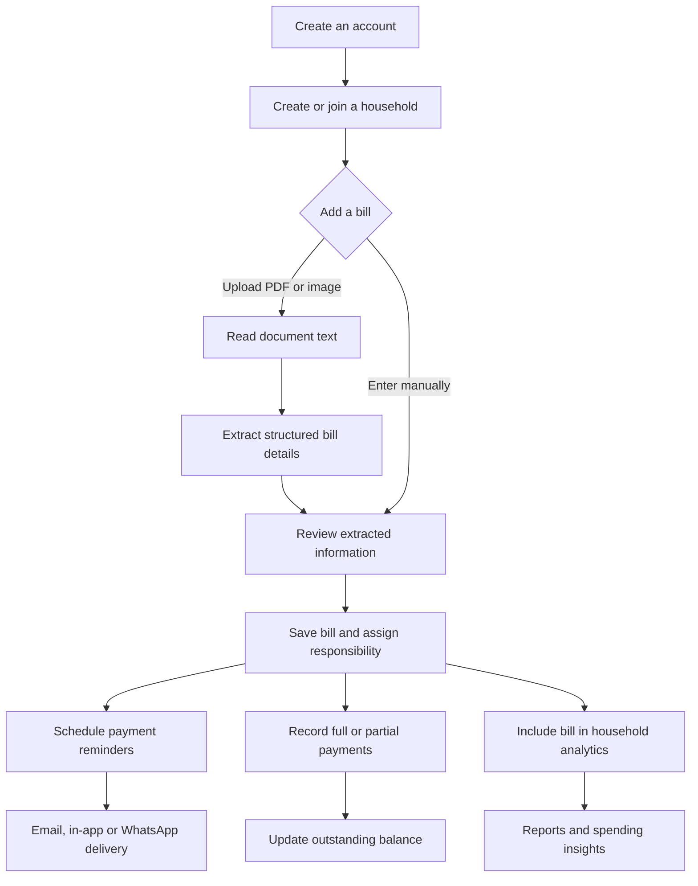
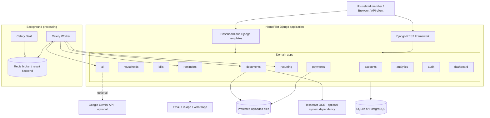
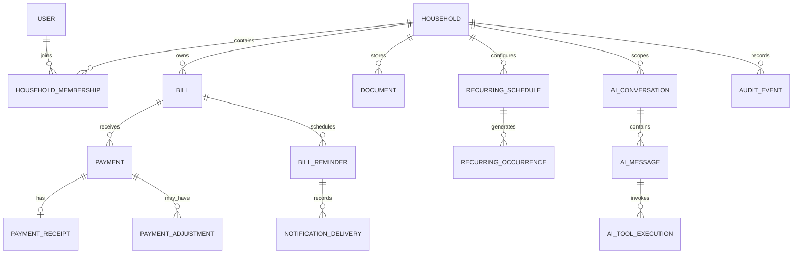

<div align="center">

# 🏠 HomePilot

### Your household bills, organised. Your payments, under control.

A household finance and bill-management platform built with Django. HomePilot brings bill collection, payment tracking, recurring expenses, reminders, analytics, and AI-assisted insights into one shared workspace for families and shared households.

<p>
  <a href="https://www.python.org/"></a>
  <a href="https://www.djangoproject.com/"></a>
  <a href="https://www.django-rest-framework.org/"></a>
  <a href="https://www.postgresql.org/"></a>
  <a href="https://www.sqlite.org/"></a>
  <a href="https://docs.celeryq.dev/"></a>
  <a href="https://redis.io/"></a>
</p>

<p><strong>Household finance · Document intelligence · Payment workflows · Automated reminders · Spending insights</strong></p>

</div>

---

## ✨ What is HomePilot?

Managing household expenses is rarely difficult because of one bill. The real challenge is keeping track of many bills, different due dates, payment responsibilities, recurring subscriptions, receipts, and the spending patterns that emerge over time.

**HomePilot gives a household one place to manage that work.** Members can upload or manually add bills, review extracted information, assign responsibility, record full or partial payments, and see what is due. Recurring schedules can generate future bills, reminders can be delivered through multiple channels, and analytics can turn historical records into useful summaries.

The project is implemented as a **Django modular monolith**: domain-specific Django apps share one application and database while keeping responsibilities separated. It includes both a browser-based dashboard and a REST API.

## 🧭 The HomePilot workflow



## 🚀 Core features

### 1. Shared household workspace

- Create a household and invite or add other registered members.
- Use household memberships as the boundary for bill and financial data access.
- Assign bills to the member responsible for paying them.
- Distinguish between **Owner** and **Member** roles.
- Keep household financial records separate from other households.

### 2. Bill management

- Add bills manually or start from an uploaded bill document.
- Organise bills by category, provider, billing period, due date, and assigned member.
- Track the bill lifecycle: `PENDING`, `PARTIALLY_PAID`, `PAID`, and `OVERDUE`.
- Recalculate totals and outstanding balances from recorded payments.
- View upcoming, overdue, paid, and assigned bills from the dashboard.

### 3. Bill document upload and extraction

HomePilot supports bill documents in **PDF, JPG, JPEG, PNG, and WEBP** formats, with a maximum upload size of **10 MB**.

The upload validation checks the file extension, MIME type/content signature, and file size. SHA-256 hashes are used to detect identical files within a household.

The document processing pipeline can:

1. Read embedded text from digital PDFs.
2. Use Tesseract OCR for image-based documents and scanned PDF content where image data is available.
3. Send extracted text to the configured structured-data extraction provider.
4. Store extracted fields and confidence information for review.
5. Flag a possible duplicate bill when provider, amount, and due date match an existing household bill.

The extraction provider is configurable:

- **Mock backend** — deterministic local/demo behaviour; no external AI key required.
- **Gemini backend** — uses the Google Gemini integration when configured.

Extracted information should be reviewed before it becomes a confirmed bill. OCR and AI extraction can make mistakes, especially with low-quality scans or unusual bill layouts.

### 4. Payment ledger

- Record multiple payments against one bill.
- Support full and partial payments.
- Track payment date, amount, method, transaction reference, and notes.
- Attach receipt files to payments.
- Record payment adjustments and reversals/voids through dedicated payment workflows.
- Derive `total_paid` and `outstanding_balance` from the payment records.
- Use transaction handling and row-level locking in payment operations to protect balance updates from concurrent requests.

Supported payment methods include UPI, bank transfer, credit card, debit card, net banking, cash, and other.

### 5. Recurring bills

Create reusable schedules for expenses that repeat over time:

- Monthly
- Quarterly
- Yearly

Schedules keep an expected amount, category, provider, assigned member, next due date, and active/paused state. The recurring service generates bill occurrences ahead of time and uses a unique schedule/period constraint to prevent duplicate occurrences when a generation task is run more than once.

### 6. Payment reminders and notifications

HomePilot can schedule reminders around important payment milestones:

| Milestone | Reminder |
|---|---|
| 7 days before | Upcoming payment reminder |
| 3 days before | Nearing due-date reminder |
| 1 day before | Last-day reminder |
| Due date | Payment due today |
| After due date | Overdue alert |

Members can configure channel and milestone preferences. Delivery channels include:

- **In-app** notifications in the HomePilot inbox.
- **Email**, using the configured Django email backend.
- **WhatsApp**, through the Meta WhatsApp Cloud API when live credentials are configured; simulation mode is also available for development.

Delivery attempts and outcomes are recorded so failed sends are not silently represented as successful deliveries.

### 7. AI household assistant

The conversational assistant keeps conversation history and can use a controlled set of **11 household-scoped tools** to retrieve information such as:

- Upcoming, overdue, and unpaid bills.
- Household and monthly spending.
- Category and provider spending.
- Spending comparisons by category.
- Payment summaries.
- Recurring bills.
- Details about an individual bill, including its payment history.

The AI does not receive unrestricted SQL or database access. Tool handlers verify household membership, and monetary totals are calculated by Django ORM/database operations and Decimal arithmetic. The model's role is to interpret and explain the returned results—not to invent financial totals.

The assistant supports a mock backend for local use and a Gemini backend when configured.

### 8. Spending insights and anomaly detection

The insights service analyses household bill history to surface patterns such as unusual spending changes, category-level increases, and upcoming expense obligations. Insights can be generated on demand or by the periodic task and dismissed from the dashboard.

These are decision-support signals, not financial advice. Check the underlying bills and payment records before acting on an alert.

### 9. Analytics and downloadable reports

The analytics module provides:

- Household overview metrics and payment completion summaries.
- Spending breakdowns by category.
- Spending totals by service provider.
- Month-over-month spending trends.
- Recurring expense and payment summaries.
- CSV exports for spreadsheet workflows.
- PDF financial statements generated with ReportLab.

### 10. Audit history and security controls

Important application events can be recorded in the audit domain, including document processing, payments, notification delivery, and AI tool execution. Audit metadata is sanitized to reduce the risk of retaining credential-like values.

The application also applies household-scoped querysets, protected document downloads, upload validation, authentication throttling, and stricter production settings.

---

## 🏗️ Architecture

HomePilot is a **modular monolith**, not a collection of independently deployed microservices. The Django project owns the presentation layer, REST API, domain services, persistence, and background task definitions.



### Django app responsibilities

| App | Responsibility |
|---|---|
| `apps.accounts` | Custom user model, registration, login/logout, and current-user endpoint. |
| `apps.households` | Household records, membership, owner/member roles, and tenant access rules. |
| `apps.bills` | Bill records, bill status, balance fields, bill document validation, and bill lifecycle APIs. |
| `apps.documents` | Document records, processing jobs, extraction results, document links, and asynchronous OCR/extraction flow. |
| `apps.payments` | Payment ledger, receipts, adjustments, reversals, and balance updates. |
| `apps.recurring` | Recurring schedules, occurrence generation, pause/resume, and catch-up operations. |
| `apps.reminders` | Reminder milestones, notification preferences, channel dispatch, and delivery history. |
| `apps.ai` | Conversational assistant, controlled tools, usage records, and spending insights. |
| `apps.analytics` | Financial aggregations, trend data, CSV exports, and PDF exports. |
| `apps.audit` | Audit events and sanitized event metadata. |
| `apps.dashboard` | Browser views, dashboard summary, and user-facing workflows. |

### Simplified data relationships



---

## 🧰 Technology stack

| Area | Technologies |
|---|---|
| Language | Python 3.12+ |
| Web framework | Django 5.1–6.x |
| REST API | Django REST Framework |
| Database | SQLite for local setup; PostgreSQL supported |
| Background processing | Celery |
| Queue / result backend | Redis |
| PDF parsing | pypdf |
| Image processing | Pillow |
| OCR | pytesseract with the Tesseract system binary |
| AI integration | Google Gen AI SDK / Gemini (optional) |
| CSV / PDF reports | Python CSV utilities and ReportLab |
| Environment configuration | python-dotenv |
| Browser UI | Django templates, Tailwind CSS CDN, Lucide icons, Google Fonts |
| Testing | pytest and pytest-django |

---

## ⚙️ Getting started

The default development configuration is designed to run locally with **SQLite**, the **mock AI providers**, console email, and eager Celery task execution. This means you can explore the application before configuring PostgreSQL, Redis, Gemini, or external notification services.

### Prerequisites

- Python **3.12 or later**.
- Git.
- Optional: Tesseract OCR, if you want to process image-based or scanned bill documents.
- Optional: Redis, if you want Celery tasks to run asynchronously instead of eagerly in the web process.
- Optional: PostgreSQL, if you prefer PostgreSQL over SQLite.

### 1. Clone the repository

```bash
git clone https://github.com/rhutik123/HomePilot.git
cd HomePilot
```

### 2. Create a virtual environment

**Windows PowerShell**

```powershell
python -m venv .venv
.\.venv\Scripts\Activate.ps1
```

**macOS / Linux**

```bash
python3 -m venv .venv
source .venv/bin/activate
```

### 3. Install Python dependencies

```bash
python -m pip install --upgrade pip
pip install -r requirements.txt
```

### 4. Create your environment file

**Windows PowerShell**

```powershell
Copy-Item .env.example .env
```

**macOS / Linux**

```bash
cp .env.example .env
```

The supplied `.env.example` selects SQLite and enables eager Celery execution. That is the recommended starting point. Keep `.env` private; it is excluded by `.gitignore`.

### 5. Apply database migrations

```bash
python manage.py migrate
```

### 6. (Optional) Create an administrator

```bash
python manage.py createsuperuser
```

### 7. Start the development server

```bash
python manage.py runserver
```

Open the application:

- **HomePilot dashboard:** http://127.0.0.1:8000/
- **Django admin:** http://127.0.0.1:8000/admin/
- **REST API root groups:** paths under http://127.0.0.1:8000/api/

The root page redirects signed-in users to the dashboard and signed-out users to the login page.

---

## 🧪 Demo data

To populate a local database with sample household records, run:

```bash
python manage.py seed_demo_data
```

The command creates a sample household, sample users, bills, payments, recurring data, notifications, and insights. It prints the demo login credentials after seeding:

| User | Role | Username | Password |
|---|---|---|---|
| Alice Sharma | Owner / Admin | `alice` | `Password123!` |
| Bob Sharma | Member | `bob` | `Password123!` |
| Carol Sharma | Member | `carol` | `Password123!` |

> **Local development only:** these are predictable demo credentials. Never use them on a public deployment. Do not run the demo seeder against a production database.

---

## 🔧 Environment configuration

The project reads environment variables from `.env` through `python-dotenv`.

| Variable | Development default / example | Purpose |
|---|---|---|
| `DJANGO_SETTINGS_MODULE` | `config.settings.development` | Selects the Django settings module. |
| `DJANGO_SECRET_KEY` | Development placeholder | Django secret key. Replace with a strong private value outside local development. |
| `DJANGO_DEBUG` | `True` in `.env.example` | Documented development flag; development settings currently enable debug directly. |
| `DJANGO_ALLOWED_HOSTS` | `localhost,127.0.0.1` | Host allowlist used by production settings. |
| `DB_ENGINE` | `django.db.backends.sqlite3` | Use SQLite or `django.db.backends.postgresql`. |
| `DB_NAME` | `db.sqlite3` | SQLite database filename or PostgreSQL database name. |
| `DB_USER` / `DB_PASSWORD` | PostgreSQL credentials | PostgreSQL connection credentials. |
| `DB_HOST` / `DB_PORT` | `localhost` / `5432` | PostgreSQL connection address. |
| `CELERY_TASK_ALWAYS_EAGER` | `True` | Runs Celery tasks synchronously for local development. Set to `False` for a worker/Redis setup. |
| `CELERY_BROKER_URL` | `redis://localhost:6379/0` | Celery broker URL. |
| `CELERY_RESULT_BACKEND` | `redis://localhost:6379/0` | Celery result backend URL. |
| `BILL_EXTRACTION_BACKEND` | `mock` | `mock` or `gemini` for bill extraction and spending-insight provider selection. |
| `AI_ASSISTANT_BACKEND` | `mock` | `mock` or `gemini` for the conversational assistant. |
| `GEMINI_API_KEY` | Empty | Google Gemini API key, required for live Gemini integrations. |
| `TESSERACT_CMD` | Optional | Full path to the Tesseract executable when it is not available on `PATH`. |
| `EMAIL_BACKEND` | Django console email backend | Prints email messages to the terminal in development. |
| `DEFAULT_FROM_EMAIL` | `HomePilot <notifications@homepilot.local>` | Sender identity for outgoing email. |
| `WHATSAPP_API_TOKEN` | Empty | Meta WhatsApp Cloud API access token. |
| `WHATSAPP_PHONE_NUMBER_ID` | Empty | Meta WhatsApp sender phone number ID. |
| `WHATSAPP_BUSINESS_ACCOUNT_ID` | Empty | WhatsApp Business Account ID setting. |
| `WHATSAPP_SIMULATION_ENABLED` | `False` | Enables simulated WhatsApp delivery for development/testing. |

### Use PostgreSQL instead of SQLite

Update the database section in `.env`:

```env
DB_ENGINE=django.db.backends.postgresql
DB_NAME=homepilot_db
DB_USER=postgres
DB_PASSWORD=replace-with-a-strong-password
DB_HOST=localhost
DB_PORT=5432
```

Create the database in PostgreSQL, then run migrations:

```bash
python manage.py migrate
```

The PostgreSQL driver (`psycopg2-binary`) is included in `requirements.txt`.

### Enable real Gemini integrations

The default configuration uses mock providers. To enable Gemini for extraction and the conversational assistant, set:

```env
BILL_EXTRACTION_BACKEND=gemini
AI_ASSISTANT_BACKEND=gemini
GEMINI_API_KEY=your_google_ai_api_key
```

Restart the Django server and any Celery workers after changing environment variables. Keep API keys out of source control and logs.

### Enable image/scanned-document OCR

`pytesseract` is a Python wrapper; the **Tesseract OCR executable must also be installed on the operating system**. Install it using the package manager or installer for your platform, then make sure `tesseract` is available on `PATH`.

When it is installed in a custom location, set `TESSERACT_CMD` in `.env`, for example on Windows:

```env
TESSERACT_CMD=C:\Program Files\Tesseract-OCR\tesseract.exe
```

Digital PDFs can use embedded text extraction through `pypdf`. Scanned/image OCR depends on Tesseract and the quality of the uploaded document.

---

## ⚡ Background jobs with Celery and Redis

For the initial local setup, `CELERY_TASK_ALWAYS_EAGER=True` means tasks execute synchronously in the Django process. You do not need to start Redis just to explore the application.

To run tasks asynchronously:

1. Install and start Redis.
2. Set `CELERY_TASK_ALWAYS_EAGER=False` in `.env`.
3. Start a Celery worker in one terminal.
4. Start Celery Beat in another terminal if you want periodic tasks to be scheduled.

**Worker — macOS / Linux**

```bash
celery -A config worker --loglevel=info
```

**Worker — Windows development**

```powershell
celery -A config worker --pool=solo --loglevel=info
```

**Celery Beat — separate terminal**

```bash
celery -A config beat --loglevel=info
```

### Periodic tasks

The Celery Beat configuration currently defines interval-based schedules for these tasks. The intervals are configured in `config/settings/base.py`; they are not fixed wall-clock execution times.

| Task | Current interval | Purpose |
|---|---:|---|
| `apps.recurring.tasks.generate_recurring_bills_task` | Daily | Generate due recurring bill occurrences up to the configured look-ahead window (15 days by default). |
| `apps.reminders.tasks.process_daily_reminders` | Daily | Queue reminders whose scheduled date has arrived. |
| `apps.reminders.tasks.check_and_update_overdue_bills` | Daily | Update overdue bill statuses and create overdue alerts. |
| `apps.ai.tasks.generate_spending_insights_task` | Weekly | Generate household spending insights. |

For production scheduling, review the Beat schedule and configure the exact execution times that suit your deployment and timezone.

---

## 🔌 REST API overview

The API uses Django REST Framework. API views require authentication by default and use session or HTTP Basic authentication as configured in `config/settings/base.py`. Session-authenticated write requests must satisfy Django's CSRF protection.

| Domain | Base path | Main capabilities |
|---|---|---|
| Authentication | `/api/auth/` | Register, login, logout, current user. |
| Households | `/api/households/` | List/create households and manage memberships. |
| Bills | `/api/bills/` | Create and manage bills; filter upcoming, overdue, and paid bills; mark paid. |
| Bill upload/review | `/api/bills/documents/` | Upload a bill document, extract fields, review/confirm data, and download the file. |
| Documents | `/api/v1/documents/` | Upload and manage documents, queue processing, retrieve extraction results, download, and confirm. |
| Payments | `/api/v1/payments/` | Record payments, attach receipts, adjust or void transactions, and view bill payment history. |
| Recurring schedules | `/api/v1/recurring/` | Manage schedules, pause/resume, trigger generation, view occurrences, and catch up missed periods. |
| Reminders | `/api/v1/reminders/` | Trigger reminders, configure preferences, inspect the inbox, and review delivery/log history. |
| AI | `/api/v1/ai/` | Manage conversations, send messages, retrieve insights, dismiss/generate insights, and inspect AI usage. |
| Analytics | `/api/v1/analytics/` | Overview, category/provider breakdowns, trends, CSV export, and PDF export. |
| Audit | `/api/v1/audit/` | Read household-scoped audit events. |
| Dashboard summary | `/api/dashboard/` | Dashboard summary data. |

### Useful endpoint examples

```text
POST   /api/auth/register/
POST   /api/auth/login/
GET    /api/auth/me/
GET    /api/households/
GET    /api/bills/
GET    /api/bills/upcoming/
GET    /api/bills/overdue/
POST   /api/bills/documents/upload/
POST   /api/bills/documents/{id}/extract/
POST   /api/bills/documents/{id}/confirm/
POST   /api/v1/documents/upload/
POST   /api/v1/documents/{id}/process/
POST   /api/v1/payments/
POST   /api/v1/payments/{id}/upload_receipt/
POST   /api/v1/recurring/{id}/pause/
POST   /api/v1/recurring/{id}/resume/
POST   /api/v1/ai/conversations/{id}/send_message/
GET    /api/v1/analytics/overview/
GET    /api/v1/analytics/reports/csv/
GET    /api/v1/analytics/reports/pdf/
GET    /api/v1/audit/
```

The API route definitions are distributed across each app's `urls.py` and viewsets. Use those files as the source of truth for request payloads, serializers, filters, and action-specific response formats.

---

## 🖥️ Browser dashboard

The browser UI is rendered with Django templates. The main routes include:

| Page | URL |
|---|---|
| Login / registration | `/login/` and `/register/` |
| Dashboard | `/dashboard/` |
| Bills | `/bills/` |
| Upload a bill | `/bills/upload/` |
| Recurring schedules | `/recurring/` |
| Notifications inbox | `/notifications/` |
| Notification preferences | `/notifications/preferences/` |
| Spending insights | `/insights/` |
| AI assistant | `/assistant/` |
| Reports | `/reports/` |
| Audit log | `/audit/` |
| Household settings | `/household/` |

The shared base template includes a dark/light theme switch and uses CDN-hosted frontend assets. A working internet connection is therefore needed for the externally hosted fonts, Tailwind CSS, and Lucide icon library to load in the browser.

---

## 🧪 Running tests

The project uses `pytest` and `pytest-django`. Run the full test suite from the repository root:

```bash
pytest -q
```

Run individual domain test suites when working on a specific area:

```bash
pytest apps/accounts/tests/
pytest apps/households/tests/
pytest apps/bills/tests/
pytest apps/documents/tests/
pytest apps/payments/tests/
pytest apps/recurring/tests/
pytest apps/reminders/tests/
pytest apps/ai/tests/
pytest apps/analytics/tests/
pytest apps/audit/tests/
pytest apps/dashboard/tests/
```

Tests use the development settings module configured in `pytest.ini`. They cover application workflows, access boundaries, document validation, payment calculations, reminders, AI behaviour, analytics, and audit handling.

---

## 🔐 Production and deployment notes

The repository includes separate development and production settings modules:

- `config.settings.development`
- `config.settings.production`

The production module disables Django debug mode, requires an explicit secret key and allowed-host list, validates the PostgreSQL password when PostgreSQL is selected, and enables HTTPS-oriented cookie/header settings.

Before deploying, review at least the following:

- Set a unique, strong `DJANGO_SECRET_KEY` and a restrictive `DJANGO_ALLOWED_HOSTS` value.
- Use PostgreSQL or another deliberately configured production database; do not deploy with demo SQLite data.
- Configure persistent, access-controlled media storage and backups for bills and receipts.
- Install and configure Redis, Celery workers, and Celery Beat if asynchronous processing is required.
- Configure real email delivery and validate provider credentials.
- Configure WhatsApp credentials only after reviewing Meta's current business messaging rules and the project guide at [`docs/WHATSAPP_BUSINESS_API_SETUP.md`](docs/WHATSAPP_BUSINESS_API_SETUP.md).
- Keep `.env`, uploaded bills, receipts, database files, and API keys out of version control.
- Verify database backups, log retention, error monitoring, and recovery procedures.
- Review the CDN dependencies in `templates/base.html` and decide whether to pin or self-host frontend assets for your deployment.
- Run the test suite and perform a deployment-specific security review before exposing the service publicly.

**Important:** the project contains useful security controls, but a repository README is not a production security certification. Review the implementation and infrastructure configuration for your own deployment.

---

## 📁 Project structure

```text
HomePilot/
├── apps/
│   ├── accounts/       # Users, authentication, demo-data command
│   ├── households/     # Households, memberships, access rules
│   ├── bills/          # Bills, bill lifecycle, bill upload/extraction flow
│   ├── documents/      # Documents, processing jobs, extraction results
│   ├── payments/       # Payments, receipts, adjustments
│   ├── recurring/      # Recurring schedules and generated occurrences
│   ├── reminders/      # Reminder engine and notification channels
│   ├── ai/             # Assistant, AI tools, spending insights
│   ├── analytics/      # Metrics and report exporters
│   ├── audit/          # Audit events and sanitization
│   └── dashboard/      # Dashboard APIs and browser views
├── config/
│   ├── settings/
│   │   ├── base.py
│   │   ├── development.py
│   │   └── production.py
│   ├── celery.py
│   ├── urls.py
│   ├── asgi.py
│   └── wsgi.py
├── docs/
│   └── WHATSAPP_BUSINESS_API_SETUP.md
├── templates/          # Django HTML templates
├── .env.example        # Example environment configuration
├── manage.py
├── pytest.ini
├── requirements.txt
└── README.md
```

---

## 🗺️ Possible next improvements

These are potential future directions rather than claims about features already implemented:

- Invitation links and a more complete household onboarding flow.
- More granular role and permission levels for larger households.
- Self-hosted frontend assets and a dedicated frontend build pipeline.
- Additional document extraction providers and per-field review tooling.
- More configurable notification schedules and delivery-provider integrations.
- Deployment automation, observability dashboards, and operational runbooks.
- API schema generation and interactive API documentation.

---

## 📄 License

No `LICENSE` file is included in this repository snapshot. Add a license file before redistributing the project or accepting external contributions under a specific license.

---

<div align="center">

**HomePilot** — make household finances easier to see, share, and manage.

Built with Django, Python, and a focus on reliable household workflows.

</div>
